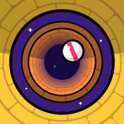
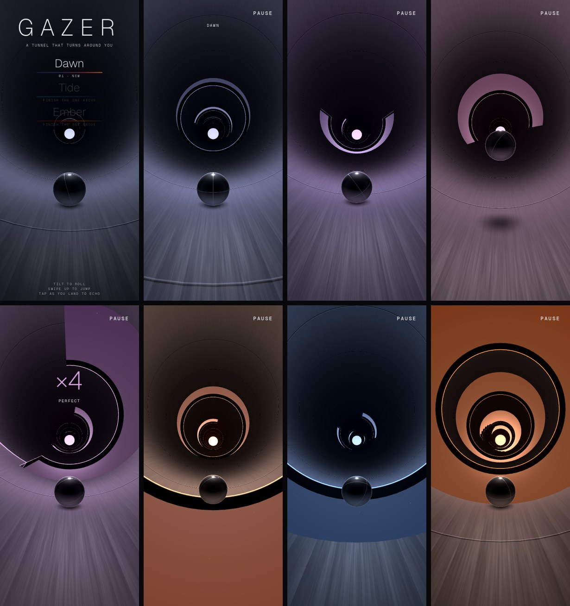

# Gazer




You are a striped cartoon ball rolling down a bright, flat-coloured tunnel. Tilt the phone and the
ball rolls across the wall as if you had tilted the floor; the camera turns
with it, so wherever the ball is on the circumference, *down* is always
under it and it is the world that rotates. Swipe up to jump (a bigger
swipe means a higher jump). Tap the moment you land and the ball **echoes**
the same jump, sending a bold ring across the wall that wraps all the way
around the tunnel and meets itself on the far side. Chain echoes and the
notes climb a scale. The echo lands with a short hit-stop (swipe during it
to change the height), and it wipes the ball's sideways momentum, so
whatever you tilt during the freeze is where it goes.

The tunnel also **spins**, gently late in the first level and harder on
each one after, carrying the ball sideways: lean against it, or ride it.
Within a level it always turns the same way and only ever speeds up. There
are seven levels of about a minute each, designed by hand: from
**Lemonade**, which introduces every mechanic once (20 m/s, a little spin
at the end), to **Supernova**, six titled acts at 34 to 51 m/s with the
tunnel turning at up to 160 °/s, designed so that nobody finishes it on the first try.
The tunnel's colour moves through each level's palette, so the colour
around you tells you how far you are and the colour ahead shows what is
coming.
The look is a deliberate throwback to Flash games: flat colours, hard
shading, thick black outlines. The holes are cut into real geometry from
the same shape the ball falls by, and every picture is checked pixel by
pixel against a ray-cast of the level (see [Checking the picture](#checking-the-picture)).



## Status

| | |
|---|---|
| Engine | Godot 4.5.1 (GDScript), Mobile renderer |
| Platforms | iOS first. Android is an export preset away (see [docs/ANDROID.md](docs/ANDROID.md)) |
| Levels in the game | Lemonade, Bubblegum, Hot Sauce, Moon Bounce, Mixtape, Screwball, Supernova (`levels/manifest.json`; see [the seven levels](docs/GAME_DESIGN.md#the-seven-levels)) |
| Levels in the folder only | `custom_level_test` (30 m/s, about 42 s): not in the manifest yet, the bots cannot finish it, see [Adding a level](#adding-a-level) |
| Level editor | Desktop app for Windows and macOS, built from this same project |
| Tests | Headless suite, including a bot that finishes every level with a human reaction delay, and a pixel oracle for the renderer |

**What has been verified and what hasn't.** Code is written and tested on
Linux: the unit tests, the level validator and the bots that play every
level all pass there, and screenshots and videos are rendered by the real
game on the iPhone's renderer (Godot's Mobile renderer, on a software
Vulkan driver), then checked by the pixel oracle. Feel can only be judged on a phone. The game has
been played on an iPhone through the CI build below; the tilt, spin and
echo tuning are still being adjusted from that. The level editor has been
built by CI but not yet tried on a real Windows PC or Mac.

## Play it on an iPhone (no Mac needed)

Every push to `main` builds an **unsigned** `.ipa` on a GitHub macOS runner.

1. **Actions → iOS ipa →** the latest green run **→ Artifacts → Gazer-ipa**.
   Unzip it to get `Gazer-unsigned.ipa`.
2. Open it in [Sideloadly](https://sideloadly.io), plug in the iPhone, enter
   your Apple ID and press Start. Sideloadly signs it with your account.
3. On the phone: Settings → General → VPN & Device Management → trust your
   Apple ID, and turn on **Developer Mode** if iOS asks.

With a free Apple ID the install lasts 7 days; sideload again after that.
The run can also be started by hand (**Run workflow**) on any branch.
GitHub's macOS runners sometimes queue for 10 minutes or more, and a new
push to the same branch cancels a build in progress.

Building and signing it yourself in Xcode, TestFlight and the App Store:
[docs/BUILDING_IOS.md](docs/BUILDING_IOS.md).

## Level editor

A desktop app for designing levels without playtesting every few seconds:
the tunnel unrolled flat, three bots replaying every edit, jump and
narrow-floor warnings, a reach cone under the mouse, and the real game as a
preview. The full guide is [docs/LEVEL_EDITOR.md](docs/LEVEL_EDITOR.md).

**Download:** **Actions → Level editor →** the latest run **→ Artifacts**.

| You are on | Download | First launch |
|---|---|---|
| Windows 10/11 | `Gazer-Level-Editor-Windows` | Unzip and run `GazerLevelEditor.exe`. SmartScreen says "Windows protected your PC": **More info → Run anyway**. Once. |
| Mac (Apple Silicon or Intel) | `Gazer-Level-Editor-macOS` | Unzip, unzip the `GazerLevelEditor.zip` inside, move **Gazer Level Editor** to Applications. Double-click it, click **Done** on the warning, then **System Settings → Privacy & Security → Open Anyway**. Once. |

If macOS says the app "is damaged", run
`xattr -dr com.apple.quarantine "/Applications/Gazer Level Editor.app"` once
in Terminal. Both apps are unsigned (no paid certificates), which is why
these steps exist.

**From the source:** open `src/editor/level_editor.tscn` in Godot and press
**F6**, or `godot --path . res://src/editor/level_editor.tscn`. Run this way
it edits the repository's own `levels/` folder; the downloaded app uses a
**Gazer Levels** folder in Documents instead.

## Adding a level

A level is one `.json` file in `levels/` (format:
[docs/LEVEL_FORMAT.md](docs/LEVEL_FORMAT.md)). It is in the game when:

1. the file is in `levels/` and named after its id (`my_level.json` for id `my_level`);
2. its id is listed in `levels/manifest.json`. The order there is the play
   order, and each level unlocks when the one before is completed.

Running the editor from the source, **File → Add to the game's level list**
does step 2 for you. The downloaded editor cannot reach the repository, so
there you save the file and commit it (or upload it on GitHub) and add the
id to the manifest by hand.

Then run the tests: every level in the manifest must be finished by the
bot with perfect reactions and with a reaction delay (0.2 s for a level
not in the test's table), so a level the bots cannot beat fails CI.
Once the tests pass and it is merged, the next iOS build has it.

Two traps:

- `tools/author_levels.gd` rewrites the seven bundled levels and the
  manifest from their scripts in `tools/levels/`. Save hand edits to a
  bundled level under a new id (and add it to the manifest again after
  re-running), or they are lost the next time it runs.
- Do not rename a shipped level's id: progress is saved by id.

## Developing

Install [Godot 4.5.1](https://godotengine.org/download) (standard, not
.NET), open `project.godot` and press **F5**. Desktop controls: **A/D** or
**←/→** tilt, **W/↑** small jump, **Space** big jump, **E/Shift** or
**click** echo, **Esc** pause. Mouse drags behave like touch swipes.

Run the tests (CI runs the same on every pull request):

```sh
godot --headless --import                         # first time: builds the class cache
godot --headless --script res://tests/run_tests.gd
```

Watch the bot play, or record it:

```sh
godot res://scenes/main.tscn -- --autoplay --level=2
godot --write-movie demo.avi --fixed-fps 60 res://scenes/main.tscn -- --autoplay --level=2
```

Useful tools, all run from the repository root:

| Command | What it does |
|---|---|
| `godot --headless --script res://tools/trace_autopilot.gd -- 02_bubblegum 0.2` | Bot plays a level with a reaction delay and prints where and why it struggles |
| `godot --headless --script res://tools/author_levels.gd` | Writes the seven bundled levels from their scripts in `tools/levels/` (see the trap above) |
| `godot --headless --script res://tools/rate_levels.gd -- all [--players 24]` | How hard each level is: the longest reaction delay the bot survives, or how often human-like bots finish |
| `godot --headless --script res://tools/trace_path.gd -- <level.json> <out.csv> [delay]` then `python3 tools/level_map.py <level.json> <out.png> <out.csv>` | A level unrolled flat as a picture, with the bot's path drawn on it |
| `godot --headless --script res://tools/idle_report.gd` | How much of each level is plain scrolling |
| `xvfb-run -a godot $MOBILE --resolution 1170x2532 res://tools/capture_screens.tscn -- <dir>` | Reference screenshots (`render_audit.tscn` for close-ups) |
| `xvfb-run -a godot $MOBILE --resolution 585x1266 res://tools/visual_audit.tscn -- <dir>` then `python3 tools/visual_oracle.py <dir>` | The pixel oracle (below) |
| `xvfb-run -a godot $MOBILE res://tools/perf_probe.tscn` | Frame time, triangles and draw calls per view |
| `python3 tools/make_icon.py` then `godot --headless --script res://tools/rasterize_icon.gd` | Redraws the app icon (`icon.svg`, `assets/icon/`) |

`$MOBILE` is `--rendering-driver vulkan --rendering-method mobile`, the
renderer the iPhone uses; without a GPU, Mesa's lavapipe driver runs it.

### Checking the picture

Rendering bugs used to come back after being fixed, because the only check
was looking at screenshots. Now there are two automated ones:

- `tests/test_tunnel_mesher.gd` (part of the test suite) checks the
  tunnel's geometry against the level definition: the floor covers exactly
  the solid wall, it is watertight across cells and chunks, every hole edge
  has a cut face, the outline is drawn from true edge distances, a chunk
  stays within its triangle budget.
- The **pixel oracle** renders several hundred views of the seven levels (around
  every kind of hole, and along a bot's run) with each material drawn as a
  flat ID colour, then ray-casts the same views from the level file alone
  and compares every pixel. It shares no code with the renderer. It fails
  on any group of wrong pixels, on any single pinhole of void and on any
  stray ink (faint outline away from every edge), with and without MSAA,
  and writes side-by-side images of what was drawn and what should have
  been. The first version of the new tunnel had 140 one-pixel pinholes
  that no screenshot showed, then thin black lines between hole corners
  that the first oracle missed; it finds both now, and both fixes are in.

### Repository layout

```
project.godot        Project settings; `.level_editor` overrides turn it into the editor app
export_presets.cfg   iOS, Android, Level editor (Windows), Level editor (macOS)
scenes/main.tscn     The game's entry scene
src/
  core/          Pure game rules: no nodes, no rendering, fully unit-tested
    level_data.gd, hole_data.gd, palette_stop.gd, spin_key.gd,
    speed_key.gd, level_hint.gd                     what a level *is*
    level_serializer.gd                            JSON <-> LevelData (read and write)
    level_validator.gd                             "is this level beatable?"
    ball_simulation.gd                             the rules, stepped at 120 Hz, deterministic
    ball_tuning.gd                                 every feel number, as a Resource
    input_frame.gd                                 device-independent player intent
    speed_profile.gd, tunnel_math.gd               shared maths
  input/         Touch, accelerometer, keyboard -> InputFrame
  gameplay/      GameSession (runs a level), Autopilot (the bot)
  presentation/  Tunnel mesher and streaming, camera, ball, effects, sound
  ui/            Menu, HUD, pause, results (built in code, see ui_style.gd)
  app/           Main state machine, settings and progress autoloads
  platform/      The only code that touches platform APIs (haptics, screen)
  editor/        The desktop level editor
shaders/         Tunnel floor, cut faces, void backdrop, ball, editor strip (holes.gdshaderinc: the editor's copy of the hole field)
levels/          Level JSON files + manifest.json (play order)
resources/       ball_tuning.tres (feel), balls/*.tres (ball looks)
assets/          Font (Lilita One), app icon PNGs (drawn by tools/make_icon.py)
tools/           Level scripts (levels/) and builder, bot trace and rating, screenshot, pixel oracle, perf and icon tools
tests/           Headless test runner and tests (tests/test_*.gd are found automatically)
docs/            Design, architecture, level format, editor and build guides
.github/workflows/
  tests.yml          Tests on every pull request and push to main
  ios-ipa.yml        Unsigned .ipa (artifact Gazer-ipa)
  level-editor.yml   Editor for Windows and macOS (two artifacts)
```

The one rule that keeps this maintainable: **data flows one way**.
`InputFrame → BallSimulation → events → presentation`. The simulation
never knows how it is drawn, and nothing visual can change gameplay. The
editor relies on this too: its bots assume the same inputs always give the
same run. Read [docs/ARCHITECTURE.md](docs/ARCHITECTURE.md) before
structural changes, and [CONTRIBUTING.md](CONTRIBUTING.md) for conventions.
A change to the level format, the hole shapes or `BallSimulation` must be
made in the editor as well (`strip_view.gd`, `shaders/editor_strip.gdshader`).

## Further reading

- [docs/GAME_DESIGN.md](docs/GAME_DESIGN.md): mechanics, numbers, feel and the visual language
- [docs/ARCHITECTURE.md](docs/ARCHITECTURE.md): layers, data flow, where to add things
- [docs/LEVEL_EDITOR.md](docs/LEVEL_EDITOR.md): the level editor: getting it, reading it, using it
- [docs/LEVEL_FORMAT.md](docs/LEVEL_FORMAT.md): the level JSON
- [docs/BUILDING_IOS.md](docs/BUILDING_IOS.md): sideloading, Xcode, signing, TestFlight
- [docs/ANDROID.md](docs/ANDROID.md): what porting involves
- [CONTRIBUTING.md](CONTRIBUTING.md): conventions and workflow

## Why Godot (and not Swift)

The brief asks for two things that pull against each other: best-practice iOS
*and* a future Android version. A native Swift/RealityKit game would be the
most Apple-idiomatic, but the Android version would be a full rewrite (and
SceneKit, the simpler Apple option, is being wound down by Apple). Godot
gives one codebase that exports a native Xcode project for iOS and an
APK/AAB for Android, is MIT-licensed with no runtime fees, and stores scenes
and resources as text, which keeps reviews readable. It also let the level
editor be the game itself, exported for the desktop. The iOS-specific good
manners (safe areas, home-indicator gesture deferral, ambient audio
session, haptics, pausing when backgrounded, keeping the screen awake) are
handled in project settings and in `src/platform/`.

## Licences

Code: choose a licence before publishing (none is set yet). Font: Lilita One,
SIL Open Font License 1.1 (see `assets/fonts/`).
All sounds are synthesised in code; there are no third-party audio assets.
