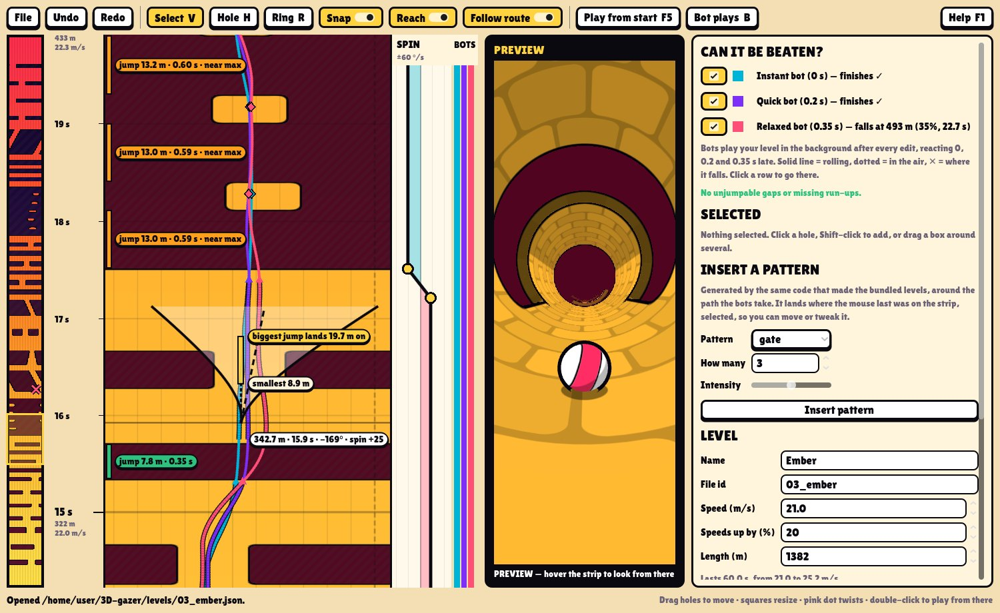

# Level editor

A desktop app for making Gazer levels, built from the game's own code: the
same level files, the same physics, the same renderer. It runs on Windows
and macOS (and anywhere Godot runs, from source).



The point of it is that **you should not have to play a level to know what
it is like.** Three bots play every edit in the background, every stretch
you must jump is measured, and the mouse shows where the ball can and
cannot get to. Play it when you want to *feel* it, not to find out whether
it works.

## Getting it

### Download a build

Every push to `main` (and every pull request that touches the game) builds
both versions on GitHub: **Actions → Level editor → the latest run →
Artifacts**.

| You are on | Download | Then |
|---|---|---|
| Windows | `Gazer-Level-Editor-Windows` | Unzip, run `GazerLevelEditor.exe`. SmartScreen says "Windows protected your PC": click **More info → Run anyway**. Only the first time. |
| Mac | `Gazer-Level-Editor-macOS` | Unzip it, then unzip the `GazerLevelEditor.zip` inside, and move **Gazer Level Editor** to Applications. See below for the first launch. |

**First launch on a Mac.** The app is not signed with a paid Apple
developer certificate, so macOS refuses to open it the first time:

1. Double-click it. macOS says it "could not verify" the app. Click **Done**
   (not Move to Bin).
2. Open **System Settings → Privacy & Security**, scroll down to the
   message about Gazer Level Editor and click **Open Anyway**, then confirm.
   (On macOS 14 and older, right-click the app → **Open** → **Open** does the
   same.)
3. From then on it opens normally.

If macOS instead says the app "is damaged and can't be opened" (it happens
with some download routes), run this once in Terminal, then open it again:

```sh
xattr -dr com.apple.quarantine "/Applications/Gazer Level Editor.app"
```

The proper fix for both platforms is code signing: an Apple Developer ID
($99/year, plus notarization) for the Mac and a code-signing certificate for
Windows. Not needed while it is a tool for a few people.

The app works on Apple Silicon and Intel Macs (it is a universal build) and
on 64-bit Windows 10/11.

### Run it from the source

With [Godot 4.5](https://godotengine.org/download) and this repository:
open the project, open `src/editor/level_editor.tscn` and press **F6**
(Run Current Scene). Or from a terminal:

```sh
godot --path . res://src/editor/level_editor.tscn
```

Run from the source, the editor opens and saves the repository's own
`levels/` folder. The exported app uses a **Gazer Levels** folder in your
Documents, filled with copies of the bundled levels the first time.

## Reading the screen

```
 ┌──┬──────┬──────────────────────────┬──────┬────┬───────────┬───────────┐
 │  │ time │                          │ spin │bots│  preview  │ inspector │
 │ m│ ruler│   the tunnel, unrolled   │ lane │lane│ (the game)│           │
 │ a│      │                          │      │    │           │           │
 │ p│      │                          │      │    │           │           │
 └──┴──────┴──────────────────────────┴──────┴────┴───────────┴───────────┘
```

**The strip** is the tunnel's wall laid flat. Distance runs *up* (the way
you travel), the angle runs *across*, and the left and right edges are the
same line (the ceiling side), so things wrap around. Holes are drawn by the
very shader code the game uses to cut them: rounded corners, holes that
melt together and twisted bands look exactly as they will play. The faint
dashed line is the floor of the start (0°).

With **Follow route** on (the default) the strip turns so the bots' route
stays in the middle, the way the game's camera keeps the ball at the
bottom. Turn it off, or Shift+scroll, to look round the tunnel yourself.

**The time ruler** (left) counts seconds of play, which is what matters to a
player, with the distance and speed every five seconds.

**The bots.** After every edit, three copies of the game's Autopilot play
the level from the start, much faster than real time:

| Colour | Bot | Reacts | Meaning if it gets through |
|---|---|---|---|
| cyan | Instant | 0 s | It is *possible*. If this one falls, nobody will finish. |
| violet | Quick | 0.2 s | A good player can do it. Every shipped level must pass this one (it is a test). |
| pink | Relaxed | 0.35 s | Most people can. Today Dawn passes it and Tide and Ember do not. |

Their paths are drawn on the strip: **solid** where they roll, **dotted**
where they fly, a **triangle** where they jump, a **diamond** where they
echo, an orange **dot** for a near miss (rolling within 0.45 m of an edge),
and a big **✕** where they fall. The bots lane on the right shows how far
each got, and the inspector says where and when each one fell (click to go
there). After an edit only the part from about 90 m before it is replayed,
so results come back in a moment.

The bots are a measure, not a person. They react late but never panic, they
do not know a level by heart, and they echo only when it is obviously safe.
A level they all pass can still feel unfair (for example a hole you only see
at the last moment because it is behind a turn). Play it.

**Jump brackets.** Every stretch where no floor is wide enough for the ball
gets a bracket on the left edge of the strip:

- **green** "jump 6.2 m · 0.29 s": fine, with how long it is in metres and in
  seconds at that speed.
- **orange** "near max": more than 80% of the biggest safe jump; or "no
  run-up": less than 1.4 m of floor before it to land on and take off from.
- **red** "TOO LONG": the biggest jump at that speed cannot clear it.

Orange bars on the *right* edge mark **narrow floor**: the widest strip of
floor there is under 1.8 m (the ball is 0.84 m wide).

**Under the mouse** (with Reach on):

- The **white cone** is everywhere a ball rolling from that point can steer
  to in the next 1.2 seconds, between full tilt left and full tilt right.
  The **dashed line** down its middle is where the ball goes with the phone
  held level: the spin's push, made visible. If the next gap is outside the
  cone, the player cannot make it from there.
- The **yellow bar** runs from where the smallest jump lands to where the
  biggest jump lands.
- The readout gives distance, time, angle and spin there.

**The spin lane** graphs the ground spin along the level: right of the centre
line pushes the ball right, left pushes it left. You set the spin in the
inspector's **Spin** section, like the speed: a direction (left, right or
none), a speed in degrees per second at the start, and how much faster it
gets by the finish. (It is saved as two spin keys, start and finish, so the
level format is unchanged. The bundled levels were made by the generator,
whose spin changes and switches direction section by section; changing the
Spin fields replaces that with one steady spin.)

**The minimap** (far left) is the whole level: problems in red, where the
bots fall, and the yellow box is what the strip shows. Click or drag on it
to go somewhere.

**The preview** is the game itself. Hover the strip and it shows what the
ball sees from that spot.

## Editing

| Do this | How |
|---|---|
| Select, move | **V** (Select tool). Click a hole; drag to move. Shift-click or drag a box for several. |
| Resize | Drag the yellow squares: bottom and top set where it starts and ends, the sides set its width. |
| Twist | Drag the pink dot above a selected hole: the hole becomes a slanted band (a winding bridge, a corkscrew). |
| Copy while moving | Hold Ctrl (Cmd on a Mac) as you start dragging. |
| Draw a hole | **H**, then drag a rectangle. |
| Place a ring | **R**, then click (same length as the last ring) or drag to set its length. |
| Repeat the selection further on | Ctrl/Cmd + **D** (it leaves 0.6 s of floor between copies: press again for a run). |
| Mirror left/right | **M** |
| Delete | **Delete** / Backspace, or right-click a hole |
| Nudge | Arrow keys: 0.5 m / 2.5° (Shift: 5 m / 15°) |
| Exact numbers | The inspector's Selected section |
| Snap | On by default (0.25 m, 2.5°). Hold **Alt** (Option) to place freely. |
| Undo / redo | Ctrl/Cmd + Z, Ctrl/Cmd + Shift + Z |
| Move along the level | Scroll, Page Up/Down, Home/End, the minimap, or middle-drag |
| Zoom | Ctrl/Cmd + scroll |
| Turn the tunnel | Shift + scroll |

**Insert a pattern** (inspector) drops in a stretch made by the same
generator that wrote the bundled levels (gates, rings, echo runs, bridges,
corkscrews, slaloms…), around the route the bots take at the mouse's
position. It *inserts*: everything after that point moves further on and
the level gets longer, so nothing overlaps. The new holes come in selected,
so you can move or tweak them straight away.

**Level settings**: name, file id, speed at the start, how much faster it
gets by the end, and length (with how many seconds that lasts; "Make it last
60 s" fits it to a minute). **Colours**: the tunnel's colour journey as
stops along the level; each has a wall, void and accent colour.

## Playing

| | |
|---|---|
| Play from anywhere | **Double-click** the strip. You start rolling right there (on a hole, you start on the bots' route instead). |
| Play from the start | **F5** |
| Watch a bot | **B**: the quick bot plays from where the mouse is. |
| Controls | A/D or ←/→ tilt, W hop, Space big jump, E echo |
| Stop | **Esc** |

While you play, the strip follows the ball and draws its track. When you
fall, a white ✕ marks the spot and you start again from the same point
after a moment, so you can drill one section. Your falls are cleared by the
next edit.

The preview uses the keyboard, so it does not tilt like a phone. It tells
you about rhythm and readability; how a section feels under a thumb and a
tilted wrist still needs the phone.

## Files and sharing

A level is one small `.json` file (format in
[LEVEL_FORMAT.md](LEVEL_FORMAT.md)). **File → Save** writes it; send it to
whoever you like, and they open it with File → Open or by dragging it onto
the editor window. **File → Show the levels folder** opens the folder.

To put a level **in the game**: the file must be in the repository's
`levels/` folder, named after its id (`my_level.json` for id `my_level`),
and listed in `levels/manifest.json` (the order there is the play order).
Running the editor from the source, **File → Add to the game's level list**
does the manifest part. Then commit, and the next iPhone build has it.

Note that the three bundled levels are written by
`tools/generate_levels.gd`: if someone re-runs that script, hand edits to
`01_dawn`, `02_tide` and `03_ember` are overwritten. Save edited copies
under a new id, or stop regenerating those levels.

## For developers

The editor lives in `src/editor/` and reuses the game rather than
re-implementing it:

| File | What it is |
|---|---|
| `level_editor.gd` / `.tscn` | The window: layout, toolbar, shortcuts, files, playtest flow. |
| `level_document.gd` | The LevelData being edited, its file, dirty flag, snapshot undo/redo. |
| `level_analysis.gd` | Background bots (threads, incremental resume from snapshots), the gap report, reach paths. |
| `strip_view.gd` | The unrolled tunnel: drawing, hit-testing, every mouse edit. |
| `minimap.gd`, `inspector_panel.gd`, `preview_panel.gd` | The other panels. |
| `editor_theme.gd` | The look, built in code. |
| `shaders/editor_strip.gdshader` | Draws the strip from the game's hole field (`holes.gdshaderinc`). |

The exports are two presets in `export_presets.cfg` with the custom feature
tag `level_editor`; `project.godot` switches the main scene, window size and
app name for that tag (`run/main_scene.level_editor` and friends), so the
phone build is untouched. `.github/workflows/level-editor.yml` builds both
from one Linux runner (the macOS app is ad-hoc signed by Godot's built-in
signer). `tools/capture_editor.tscn` renders the screenshots used here.

Rules the editor depends on: BallSimulation must stay deterministic (the
incremental analysis assumes the same inputs give the same run, and
`test_analysis_resumes_exactly_after_an_edit` checks it), and the bots must
not look further ahead than `LevelAnalysis.RESUME_MARGIN` (90 m).
